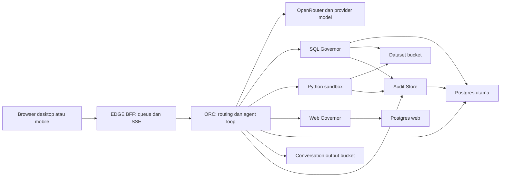

# Audit ORC: reasoning dan penyajian 48k/48k

Inspeksi 19 Oktober 2026, `lucid-patience/dev`. Baseline audit sebelum implementasi; rencana disetujui untuk dijalankan pada 2026-10-19 dan dipindahkan ke
[`EXEC.md`](../../EXEC.md#exec-orc-budget--reasoning-dan-penyajian-2026-10-19).
Baseline Git saat audit: `cf82949`; versi aplikasi per service ada di `INFRA_INSPECTION.json`.

## Bukti dan batas inspeksi

- `INFRA_INSPECTION.json`: delapan service, source, deployment SUCCESS, replica, volume, metrics empat jam,
  dan ringkasan log. Tidak menyimpan pertanyaan user, teks reasoning, credential, atau URL bertanda tangan.
- `CONFIG_AND_DATABASE.json`: hanya variabel nonrahasia yang disebutkan, hasil perbandingan credential berupa
  boolean, dan SELECT metadata melalui pgweb. `transaction_read_only=on`, `rows_affected=0`.
- Source aplikasi utama dari `rednightt33/saniti`, branch `main`; PostgreSQL dari image Railway. Tidak ada
  staged change pada delapan service yang diinspeksi. Versi aktif masing-masing service berbeda sesuai watch path.
- Semua service online, satu replica. Postgres utama mempunyai satu critical notification yang penyebabnya
  tidak disediakan health tool; bukan dinyatakan sehat tanpa syarat. Disk terukur sekitar 40,94 GB pada volume
  yang dikonfigurasi 50 GB (~82%). Tidak ada tindakan memperbesar atau menghapus data.
- Lima sambungan credential diperiksa kesamaannya: BFF→ORC, ORC→sandbox/SQL/Web, sandbox→dataset SQL.
  Ini bukan uji panggilan berbayar atau bukti semua dependency selalu reachable.
- Schema `ai_audit` tidak dapat diinspeksi lewat role pgweb; pembacaan pertama ditolak, lalu query dipersempit
  ke metadata public. Tidak menaikkan privilege. Tabel percakapan, turn, output, execution, export, memory,
  dan ringkasan audit public terkonfirmasi ada.
- Tidak ada inference live, extraction, eksekusi script sandbox, export, fault injection, perubahan aplikasi,
  variabel Railway, DDL, grant, ataupun deployment. Tes menggunakan fake client/in-memory stores.

## Dependensi dan dampak

Diagram merangkum akses logis. ORC menulis audit lewat outbox pada Postgres; SQL Governor tetap satu-satunya
jalur SQL data pasar untuk AI. Akses bucket dataset dari sandbox memakai kontrak akses Governor, bukan
pemberian credential bucket baru. Web Governor mempunyai model dan anggaran internal sendiri; 48k/48k yang
disetujui menyangkut AI pelaksana pilihan user, bukan penggantian otomatis model helper.

## Hasil audit kode

| Bagian | Bukti source | Temuan |
|---|---|---|
| Pilihan model | `apps/market-ai-orc/app/model_choices.py:41` | DeepSeek/GLM effort; MiMo On/Off dengan output On 12k; Qwen On reasoning 8k. |
| Output per panggilan | `app/orchestrator.py:4660,4681` | Satu cap output gabungan, diisi ulang pada setiap panggilan; tidak ada output-total-per-run yang setara cap ini. |
| Penurunan level | `app/orchestrator.py:4422,4552,4666` | Setelah timeout 90 detik, runaway kosong pada cap, dan respons pertama fastlane. On/Off dapat menjadi Off. |
| Metadata level | `app/orchestrator.py:7761`; BFF `static/edge-view.js:240` | Metadata final memakai pilihan user, bukan daftar level yang benar-benar dikirim per panggilan. |
| Deadline dan retry | `app/openrouter_client.py:241,262` | Total deadline diperiksa saat byte dibaca; timeout/network/status sementara bisa diulang sampai tiga attempts. Waktu retry perlu memakai remaining budget, bukan mengulang deadline penuh. |
| Anggaran run | `app/orchestrator.py:4386`; `app/mode4.py:393` | Inner analysis 1800 detik; Mode4 default 3600; pemeriksaan loop bukan pembatalan keras seluruh request di tengah provider wait. |
| Stop | `app/stop.py:1` | Flag mencegah pekerjaan/panggilan berikutnya; panggilan yang sedang berjalan tidak langsung berhenti atau otomatis direfund. |
| Persist sandbox | `apps/market-python-sandbox/app/sessions.py:1` | File output dan execution records disimpan sebelum model dapat membaca hasil; bukan menyimpan reasoning yang belum diterima. |
| Persist ORC | `app/orchestrator.py:3172,3538,3757` | Output/kode disalin ke conversation store dan memory disimpan setelah loop/finalisasi selesai, termasuk kegagalan yang tertangani. |
| Memory immutable | `app/run_memory.py:225`; migration `20261006_003` | Satu row terminal per run, INSERT ON CONFLICT DO NOTHING; tidak boleh dipakai sebagai checkpoint RUNNING. |
| Perbaikan final | `app/orchestrator.py:7482,7523` | Draf dapat di-echo dan diminta ulang; tiap permintaan baru punya jatah baru. Bukan dua anggaran reasoning/penyajian terpisah. |
| Tabel | `app/table_directives.py:1`; `app/orchestrator.py:6180` | Sudah dirender backend dari output/references; pertahankan. Batas chat 50 baris/12 kolom adalah batas tampilan, bukan batas output AI. |
| Konteks | `app/orchestrator.py:4398,4410,5230` | Cap output ikut dicadangkan saat memeriksa konteks. Cap 96k menurunkan headroom input, walau token aktual sedikit. |
| History/draf | `app/conversations.py:52`; `app/run_memory.py:40`; `app/orchestrator.py:7511` | History punya pointer untuk jawaban >40k karakter; salinan draf/trace juga berbatas. Itu batas karakter, bukan token user-visible. |
| Audit | `app/audit.py:31`; `app/audit_outbox.py:26,97` | Ringkasan legacy answer 20k karakter; final artifact hingga 1 juta karakter; event draf dibatasi. Jangan menyamakan ringkasan dengan respons yang ditampilkan. |
| BFF | `apps/edge-bff/app/worker.py:32,69`; `app/config.py:19` | Satu worker/owner aktif, tunggu 3900 detik, lease 90 detik dengan heartbeat 20 detik. Retry transport mempertahankan request id. |
| Mobile | BFF `app/main.py:379`; `static/edge-client.js:27` | SSE snapshot/ping, rotasi koneksi 240 detik dan reconnect/polling. Bukan token streaming dari model. |
| Idle sandbox | `apps/market-python-sandbox/app/config.py:290`; `app/sessions.py:488` | Idle default 900 detik dan umur default 3600. Beberapa panggilan tanpa aktivitas tool juga dapat melewati idle, bukan hanya satu panggilan panjang. |
| Model helper | `app/conversation_router.py`, `app/follow_ups.py`; Web `app/config.py:235` | Router/klasifikasi/saran tetap punya kontrak kecil. Timeout Web 90 detik adalah pengaturan lain, bukan fastlane executor 90 detik. |

`app/` pada tabel berarti `apps/market-ai-orc/app/`, kecuali disebutkan lain. Angka baris merujuk baseline audit.

## Kontrak provider: yang diketahui dan yang belum dijamin

Kode hanya mengirim batas reasoning numerik untuk Qwen. Angka 8000 berasal dari aplikasi. DeepSeek/GLM menerima
effort, MiMo menerima On/Off. Tidak ditemukan kontrak yang menjamin rasio token tetap Low/High/Max pada tiga
model itu; angka persentase generik tidak digunakan sebagai hard cap.

Target user adalah **48.000 reasoning dan 48.000 kapasitas penyajian**, bukan 48.000 total. Untuk provider yang
benar-benar membatasi reasoning dalam output gabungan, anggaran tersebut memerlukan total hingga 96.000.
Jatah sisa bukan jumlah token yang wajib ditulis. Input/history tetap di luar output.

Belum dibuktikan bahwa semua endpoint yang bisa dipilih routing saat ini menerima 96k output, mendukung
hard cap reasoning 48k, atau menghormati pembagian itu. Bahkan pada Qwen, dukungan parameter tidak membuktikan
bahwa nilai 48k berada dalam rentang yang diterima endpoint. Pemanggilan terpisah untuk penyajian dengan Max
juga dapat menghabiskan output pada reasoning lagi. G0 pada PLAN adalah gate implementasi, bukan asumsi.

Sumber primer yang diperiksa:
- [OpenRouter reasoning dan gabungan output](https://openrouter.ai/docs/guides/best-practices/reasoning-tokens).
- [OpenRouter Qwen endpoints](https://openrouter.ai/api/v1/models/qwen/qwen3.8-flash/endpoints).
- [Alibaba thinking budget](https://www.alibabacloud.com/help/en/model-studio/deep-thinking).
- [GLM model card](https://huggingface.co/zai-org/GLM-5.3-Flash).
- [DeepSeek serving/effort](https://recipes.vllm.ai/deepseek-ai/DeepSeek-V4.1-Flash).
- [MiMo endpoints](https://openrouter.ai/api/v1/models/xiaomi/mimo-v2.6-flash/endpoints).

## Log dan tes baseline

Log 17–19 Oktober: 227 `ai_model_call` records (termasuk dua manual troubleshooting), 10 fastlane timeouts.
DeepSeek 61 calls: median output 1173, maksimum 6505. MiMo 159: median 1667, maksimum 12000. GLM 5: median
970, maksimum 1899. Ini campuran level/jalur; bukan benchmark Max-only. Latency mencakup retry di transport.
Log 12–19 Oktober: tujuh reasoning-runaway dan satu tool-output-truncated; nol matching final-truncated events
dalam pencarian ini bukan bukti bahwa truncation tidak pernah terjadi. Attempts yang dibatalkan tanpa usage
tidak dapat dihitung sebagai biaya nol.

Existing mocked tests yang dijalankan pada baseline: **15 passed, 1 skipped**, 0,69 detik; satu warning dependency.
Selector: dua test downgrade di `test_fastlane.py`; parameter reasoning, MiMo cap dan runaway di
`test_exec_models.py`; timeout retry di `test_openrouter_client.py`; persistence di `test_result_store.py` dan
failed-run memory di `test_run_memory.py`. Parameterized selector menghasilkan lebih dari delapan test cases.
Belum menguji implementasi baru atau UI baru; acceptance untuk perubahan ada di PLAN.

Source implementation and local validation: [IMPLEMENTATION.md](IMPLEMENTATION.md). Live migration/config/deployment remain pending; the audit above describes the inspected baseline.
